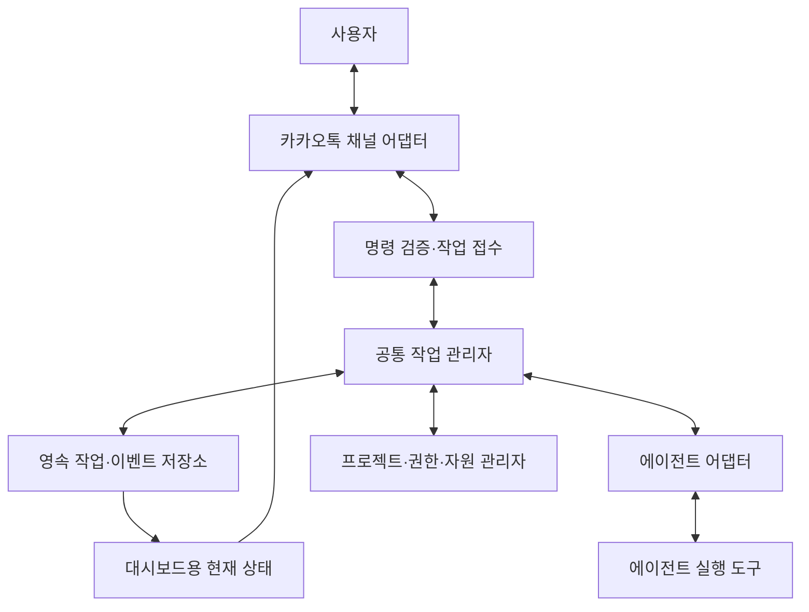

# 범용 에이전트 하네스 설계 참고서

작성일: 2026-10-23

## 1. 문서의 성격

이 문서는 여러 OS와 에이전트 실행 도구를 연결하는 **새 하네스의 설계 제안**이다. 특정 앱 플랫폼의 SDK, 배포 콘솔, 브랜드 자산, 실기기 디버깅 절차를 제품 요구사항에서 제외했다. 분석 출처와 원본의 구체 구현은 [원본 분석](TOSS_HARNESS_ANALYSIS.md)에 별도로 보존한다.

이 문서의 명령, 데이터 예시, 상태 이름과 디렉터리 구조는 제안이다. 현재 동작하는 API나 이미 구현한 제품 사양이 아니다. 구현 순서와 통과 기준은 [인수인계](IMPLEMENTATION_HANDOFF.md)를 따른다.

## 2. 제품의 목표

사용자는 휴대폰의 카카오톡에서 등록된 작업환경에 작업을 맡긴다. 각 환경의 실행기는 프로젝트와 에이전트를 선택해 작업을 실행하고, 추가 질문·진행 상황·결과를 같은 채널로 돌려준다. 사용자는 `/대시보드`로 총괄과 하위 에이전트의 상태를 확인한다.

범용성은 다음 네 축으로 정의한다.

| 축 | 의미 | 검증 단위 |
| --- | --- | --- |
| OS | Windows·macOS·Linux에서 설치·시작·종료·복구 | OS 및 CPU 조합 |
| 실행 도구 | 여러 에이전트의 세션·이벤트·권한 처리 | 어댑터와 도구 버전 |
| 작업 도메인 | 코드·문서·조사 등 서로 다른 작업 | 스킬과 사용 도구 |
| 명령 채널 | 카카오톡 등 입력·출력 경로 교체 가능 | 채널 어댑터 |

모든 도구가 같은 기능을 가진다고 가정하지 않는다. 지원 범위는 `지원 / 제한 지원 / 미지원 / 미검증`으로 표시하고 버전·OS·검증일을 함께 기록한다.

## 3. 계층 구조



- **채널 어댑터:** 메시지를 받거나 보낸다. 프로젝트 접근 권한이나 실행 정책을 스스로 확대하지 않는다.
- **명령 접수:** 발신자·대상 방·명령 형식·중복 여부를 검증한다.
- **작업 관리자:** 작업·시도·세션·승인·의존성을 연결한다.
- **에이전트 어댑터:** 특정 도구의 시작·추가 지시·중단·이벤트를 공통 계약으로 변환한다.
- **플랫폼 어댑터:** 경로·프로세스·권한·비밀정보 저장·서비스 실행 차이를 처리한다.
- **저장소:** 재시작 후 복구할 작업 장부와 이벤트를 보관한다.
- **상태 조회:** 같은 이벤트에서 카톡 요약과 로컬 화면을 만든다. 조회 자체가 새 작업을 실행하지 않는다.

단일 PC 내부 구현부터 시작한다. 여러 PC를 하나의 카톡 대시보드에 모으는 기능은 별도의 기기 등록·인증·집계 계약이 필요하다. 공통 코드가 설치돼 있다는 사실만으로 기기들이 서로 연결되는 것은 아니다.

## 4. 서로 다른 객체를 분리한다

| 객체 | 책임 | 혼동하면 생기는 문제 |
| --- | --- | --- |
| Device | 작업이 실행되는 환경의 등록 정보 | 같은 프로젝트 별칭이 다른 PC 경로를 가리킴 |
| Project | 사용자 별칭·로컬 경로·허용 범위 | 메시지에 포함된 임의 경로로 작업 실행 |
| Task | 사용자가 맡긴 논리적 작업 | 재시도를 새 요청으로 착각 |
| Attempt | 작업을 실제 실행한 한 번의 시도 | 이전 실행의 늦은 이벤트가 현재 상태를 덮음 |
| AgentSession | 특정 실행 도구의 문맥 | 다른 도구에 같은 세션 ID를 전달 |
| AgentRun | 한 시도에서 특정 역할을 수행하는 에이전트 | 부모 작업과 하위 에이전트 상태가 뒤섞임 |
| Approval | 특정 행동에 대한 승인 요청 | 과거의 일반적인 승인을 새 행동에 적용 |
| ResourceLease | 계정·파일·브라우저 등의 사용권 | 서로 다른 에이전트가 같은 자원 변경 |
| Artifact | 결과 파일·검사 증거 | 긴 로그·비밀정보를 카톡에 그대로 전달 |

프로젝트는 사람이 읽는 별칭으로 선택하고 각 기기의 경로 매핑은 로컬 설정에서 해결한다. 작업 ID는 채널·모델·OS가 바뀌어도 유지하고, 실행 도구의 세션 ID는 해당 어댑터 내부에 둔다.

## 5. 명령 접수와 중복 처리

### 5.1 명시적인 명령 경계

초기에는 지정한 방·발신자·접두사를 모두 확인한다. 일반 대화나 첨부 자료에 들어 있는 문장을 실행 명령으로 승격하지 않는다. 에이전트가 보낸 답변도 다시 작업으로 받아들이지 않는다.

카톡 명령과 도구 내부 슬래시 명령은 별개다. `/대시보드`는 공통 작업 관리자의 조회 API를 부르고, `/작업 요청`은 검증된 작업 입력을 만든다. 자연어 해석을 붙여도 권한·대상 검증은 결정적 코드에서 수행한다.

### 5.2 영속적인 접수 장부

```json
{
  "commandId": "cmd_example_01",
  "deviceAlias": "work-laptop",
  "projectAlias": "sample-project",
  "requestedAgent": "agent-a",
  "operation": "analyze",
  "instruction": "최근 변경의 위험을 조사해 주세요",
  "receivedAt": "2026-10-23T00:00:00Z"
}
```

이 예시는 내부 계약이며 카카오 서버의 실제 필드 형식이 아니다. 방·계정·원문 식별자는 필요한 최소 범위에서 검증하고 보호한다. 외부 응답에는 내부 원문 식별자를 그대로 노출하지 않는다.

접수 중복키는 검증된 출처와 원래 메시지 식별을 바탕으로 내부에서 생성하고, 작업 생성과 같은 트랜잭션에 기록한다. 브라우저 표시용으로 세션마다 바뀌는 메시지 키는 영속 중복키로 바로 사용하지 않는다.

메시지 수신 이벤트와 접수 장부 기록 사이의 실패도 다룬다. 가능한 경우 재전달을 허용하고 장부에서 중복을 흡수한다. 메시지 손실·네트워크 단절·외부 부작용까지 포함한 전역적인 정확히 한 번 실행을 보장한다고 표현하지 않는다.

## 6. 작업 상태와 이벤트

### 6.1 공통 상태

| 상태 | 의미 | 필요한 근거 |
| --- | --- | --- |
| queued | 접수됐으나 실행 전 | 영속 접수와 대기열 등록 |
| running | 현재 시도가 실행 중 | 실행 시작과 최근 활동 |
| waiting_user | 답변·승인 대기 | 유효한 요청 ID와 질문 |
| waiting_dependency | 선행 작업·자원 대기 | 의존 작업 또는 자원 정보 |
| completed | 현재 범위의 실행 완료 | 어댑터 종료 결과와 산출물 |
| failed | 현재 시도 실패 | 분류된 오류와 재시도 정책 |
| cancelled | 취소가 실제 확인됨 | 실행기·하위 자원 종료 확인 |
| reconciling | 실행 상태를 복구·대조 중 | 재시작·연결 유실 뒤 대조 기록 |

장치의 `online / stale / offline / unknown` 상태는 작업 상태와 별도로 관리한다. heartbeat가 오래됐다는 이유만으로 작업을 실패·완료로 바꾸지 않는다. 중단 요청을 보냈다는 사실도 실제 중단과 구분한다.

### 6.2 이벤트 예시

```json
{
  "schemaVersion": 1,
  "eventId": "evt_example_03",
  "taskId": "task_example_12",
  "attemptId": "attempt_example_02",
  "agentRunId": "run_example_review",
  "sequence": 7,
  "kind": "stage_changed",
  "stage": "reviewing_changes",
  "occurredAt": "2026-10-23T00:00:00Z",
  "receivedAt": "2026-10-23T00:00:01Z"
}
```

검증·최소화한 내부 상태 이벤트를 기록하고 현재 상태는 그 기록에서 계산한다. 에이전트의 전체 입출력·카톡 대화 원문을 자동 저장한다는 뜻은 아니다. 이벤트 순서는 장치의 시계만 믿지 않고 발신 실행의 순번과 수신 순서를 함께 사용한다. 실행 기한 계산에는 가능한 범위에서 단조 시계를 사용한다.

이전 시도의 늦은 이벤트는 감사 기록에 남길 수 있지만 현재 시도의 상태를 변경하지 못하게 한다. 종료 이벤트가 중복 도착해도 완료 알림과 후속 작업을 중복 생성하지 않는다. 저장에 실패했는데 성공 상태만 카톡으로 먼저 보내는 순서는 피한다.

### 6.3 실행 완료와 검증 판정

에이전트의 `completed`와 요구사항의 검증 성공은 별개다. 예를 들어 수정안 작성은 완료됐지만 실제 기기 검증은 미실행일 수 있다. 결과에는 다음을 따로 보관한다.

- 실행 상태와 종료 이유
- 요구사항별 `검증 성공 / 부분 성공 / 실패 / 미실행`
- 실제 수행한 검사·환경·산출물
- 알려진 제한과 다음 확인 사항

## 7. 에이전트 어댑터의 최소 계약

다음은 개념 인터페이스다. 특정 공급사의 실제 SDK 메서드 이름이 아니다.

```text
inspectCapabilities(environment) -> capability report
startTask(task, workspace, policy) -> execution handle
submitFollowup(handle, message) -> delivery result
resumeTask(savedSession, workspace, policy) -> execution handle or unsupported
observeEvents(handle) -> event stream
answerRequest(handle, requestId, decision) -> resolution result
requestStop(handle) -> stop request result
reconcile(handle) -> observed execution state
```

어댑터는 시작·관측·중단·재개·승인 중 무엇을 지원하는지 선언한다. 재개가 없는 도구에 새 프로세스를 열고 같은 문맥이 이어졌다고 표시하지 않는다. 모델 API에 텍스트를 보내는 기능만으로 파일·셸·브라우저를 가진 작업 에이전트가 완성됐다고 보지 않는다.

추가 지시는 `접수됨 / 실행 도구에 전달됨 / 새 차례 시작됨 / 처리 결과 확인됨`을 구분한다. 기존 실행이 끝난 뒤 새 차례를 시작하는 기능, 진행 중 지시를 보태는 기능, 종료된 세션을 재개하는 기능은 각각 능력으로 선언한다. `reconcile`은 관측·대조이며 작업을 재실행하는 기능이 아니다.

열린 데스크톱 앱의 기존 세션을 직접 조작하는 기능은 별도의 연결 방식이다. CLI·SDK로 새 작업을 실행하는 기능과 혼동하지 않는다. 추적 범위는 하네스가 시작했거나 명시적으로 상태 연동한 실행으로 한정한다.

## 8. 멀티에이전트와 자원 소유권

총괄 에이전트는 작업을 분해할 수 있지만, 실행 가능 여부와 권한 검사는 공통 실행기가 확정한다. 작업 분배를 모델의 설명 문장만으로 처리하지 않는다.

- 독립적인 조사·검토는 병렬화한다.
- 같은 파일을 수정하는 작업은 소유권을 나누거나 순차 실행한다.
- 계정·브라우저 프로필·기기 연결은 자원별 사용권을 가진다.
- 테스트 캐시·포트·임시 디렉터리는 실행별로 분리한다.
- 하위 에이전트 수와 실행 비용에는 실제 한도를 둔다.
- 선행 작업의 승인된 산출물과 버전을 후행 작업에 전달한다.
- 재할당 전 이전 실행의 종료·소유권 해제를 확인한다.

의존 그래프는 순환을 거절하고, 자원 대기와 선행 작업 대기를 구분한다. 동시에 실행된 에이전트가 많다는 사실을 멀티에이전트 협업 성공으로 판정하지 않는다.

사용권 획득은 원자적으로 처리하고 소유 토큰과 세대 번호를 둔다. 해제·갱신 시 현재 소유자가 일치하는지 검사한다. 죽은 실행의 자원을 새 실행이 회수한 뒤에는 이전 소유자의 늦은 쓰기·해제가 새 소유권에 영향을 주지 못하게 한다. 공유 파일의 읽기 후 일반 쓰기만으로 상호 배제를 보장한다고 보지 않는다.

## 9. 승인과 권한

승인은 실행기에서 강제한다. 스킬에 승인 문구를 쓰는 것만으로 외부 행동을 차단했다고 보지 않는다.

승인 요청에는 작업·시도·요청 ID, 대상, 행동 범위, 변경 또는 부작용 요약, 만료 시각을 연결한다. 작업이나 내용이 바뀌면 과거 승인으로 실행하지 않는다. 승인 처리가 중복 도착해도 같은 행동을 다시 실행하지 않는다.

프로젝트 범위를 넓히기, 외부 발송, 배포, 계정 연결 변경 등은 서로 다른 권한으로 다룬다. 에이전트 도구의 샌드박스·권한 정책을 유지하며, 비대화형 실행을 위해 승인 우회 옵션을 기본값으로 설정하지 않는다.

카카오톡으로 승인 내용을 전달하는 것과 특정 실행 도구의 승인 요청을 실제 해소하는 것은 별개 단계다. 해당 어댑터가 안전하게 응답할 수 없으면 로컬 확인이 필요한 상태로 남긴다.

## 10. 수명·장애·불명 결과

작업의 수명과 카톡 연결·브라우저 화면의 수명을 분리한다. 브라우저 탭 종료가 진행 중 작업을 암묵적으로 삭제하게 만들지 않는다. 채널 연결 유실 시에는 새 권한 승격·외부 행동을 진행할지에 대한 사전 정책을 적용하고, 결과는 로컬 장부에 남긴다.

재시작 시에는 실행 ID와 프로세스 정체성을 대조한다. PID 하나만으로 이전 작업의 소유자를 신뢰하지 않는다. 살아 있는 실행을 무조건 중복 시작하거나 다른 사용자 프로세스를 강제 종료하지 않는다.

부작용의 결과가 불명확하면 자동 재실행하지 않는다. 예를 들어 발송 후 응답만 잃어버린 경우, 발송을 반복하는 대신 원래 작업의 결과를 대조하고 사용자에게 불명 상태를 알린다. 에이전트 작업과 카톡 회신은 각각 별도의 발송·실행 장부를 가진다.

모든 요청에는 기한을 둔다. 기한 초과는 취소 요청·종료 확인·부분 산출물 보존과 연결하되, 단순히 타이머가 끝났다는 이유로 외부 실행까지 종료됐다고 표시하지 않는다.

정상 종료는 새 작업 수락 중단, 상태 저장, 실행 종료 확인, 연결 정리 확인, 자원 반환을 순서대로 다룬다. 알림 수신 확인을 기다리느라 종료가 무한 대기하지 않도록 기한과 결과를 기록한다. 강제 종료로 정리를 못 한 경우에는 다음 시작에서 소유권과 실제 프로세스를 대조한다.

## 11. 카카오톡 대시보드

대시보드는 저장된 현재 상태를 읽어 표현한다. 조회를 위해 모든 에이전트에게 새 추론 작업을 시키지 않는다.

```text
📊 작업 대시보드 — 예시
기준 시각: 09:32:10 · 마지막 관측: 5초 전

work-laptop · 연결됨
#12 sample-project — 변경 검토
├ 총괄 agent-a   진행 중 · 결과 수집
├ 구현 agent-b   진행 중 · 수정안 작성
└ 검토 agent-c   선행 작업 대기

#13 문서 정리 — 사용자 확인 필요
기간 선택 요청 A7 · 상세: /작업 13
```

기본 조회 항목은 기기·프로젝트·목표·총괄/하위 관계·상태·현재 단계·마지막 활동·질문·요약 결과다. 실제 분모가 있는 검사만 개수·진행률을 표시한다. 자유로운 분석 작업에 임의의 완료 퍼센트를 만들지 않는다.

긴 로그·diff·결과 파일은 로컬 산출물로 보관하고 카톡에는 필요한 요약을 보낸다. 비밀정보나 실제 대화 본문이 에이전트 로그를 통해 역으로 노출되지 않게 출력 경계를 둔다. 공개 URL이나 터널을 기본 생성하지 않는다.

명령 예시는 `/대시보드`, `/대시보드 <기기>`, `/작업 <번호>`, `/확인목록`, `/중지 <번호>`다. 작업이 여러 개면 추가 지시의 대상 작업을 명시적으로 결정하고, 애매한 자연어를 임의의 실행에 연결하지 않는다.

## 12. OS 독립 설치와 업데이트

공통 실행 코드는 경로·임시 디렉터리·실행 파일 확장자·시그널·권한·서비스 등록을 직접 가정하지 않는다. 임시 경로는 OS API로 구하고, 프로그램 실행은 가능한 한 셸 문자열 대신 인자 배열로 전달한다.

플랫폼별로 다음을 구현·검증한다.

| 경계 | 확인할 내용 |
| --- | --- |
| 경로 | 공백·한글·드라이브·심볼릭 링크·허용 루트 |
| 프로세스 | 부모/자식·종료·고아 작업·실행기 재시작 |
| 저장 | 사용자 전용 위치·접근 권한·설치별/계정별 격리 |
| 비밀정보 | OS 자격증명 저장소 또는 검토한 비밀정보 제공 방식 |
| 서비스 | 사용자 세션·로그인·절전·재부팅 후 동작 정책 |
| 네트워크 | 프록시·TLS·단절·재접속·중복 수신 |
| 설치 | 신규 설치·반복 실행·사용자 설정 보존·버전 이동 |

설치기는 환경 진단과 변경 실행을 분리한다. 이미 같은 설정이면 유지하고, 사용자 항목을 통째로 덮어쓰지 않는다. 충돌한 항목은 차이를 보여주고 해결한다. 전역 에이전트 설정은 기본 설치 대상에 포함시키지 않는다.

실행기 버전, 어댑터 버전, 통신 스키마 버전은 구분한다. OS 지원표에는 CPU와 도구 버전·검증일을 포함한다. CI에 OS 이름이 있다고 해서 실제 카카오 로그인·수신까지 검증됐다고 표현하지 않는다.

호환성 확인 정보가 없는 경우는 `미확인`이다. 불일치 응답이 없었다는 이유로 호환 검증 성공으로 승격하지 않는다. 인증 완료, 프로젝트 권한, 대상 실행 일치, 자원 사용 가능 여부도 별도 결과로 다룬다.

## 13. 새 저장소의 구성 제안

```text
packages/
  runtime/              # 작업·상태·승인·영속 장부
  protocol/             # 공통 계약과 버전
  adapters/             # 에이전트 실행 도구 연결
  channels/             # 카카오톡 등 입력·출력
  platform/             # OS별 경로·프로세스·비밀정보
  cli/                  # 진단·설치·시작·상태·종료
skills/                 # 제품과 독립적인 작업 절차
integrations/           # 에이전트 도구별 설정·플러그인
docs/                   # 공개 설계·검증·사용 안내
tests/                  # 합성·로컬 통합·계약 검사
```

이는 책임 구분이며 처음부터 모든 디렉터리를 패키지로 발행하라는 뜻은 아니다. 초기에는 작은 모듈로 구현하고 독립 배포가 필요할 때 패키지를 분리할 수 있다.

공개 설정 예시에는 프로젝트 별칭과 상대적 기본값만 두고, 사용자 경로·로그인 자료·실제 실행 장부는 Git에서 제외한다. 이후 실행을 재현하는 데 필요한 비민감 테스트·설치 문서는 공개 저장소에 포함한다.

## 14. 설계 채택 전 확인할 사항

1. 각 OS에서 카카오톡 명령 수신과 결과 회신이 독립적으로 되는가?
2. 명령용 방과 발신자를 안정적으로 검증할 근거가 있는가?
3. 재접속·재인증·재시작 뒤에도 명령을 중복 실행하지 않는가?
4. 지원할 에이전트 도구의 실제 실행·추가 지시·승인·중단 인터페이스는 무엇인가?
5. 세션과 자원 수명·불명 결과·기기 단절을 어떻게 대조하는가?
6. 대시보드가 실제 이벤트와 마지막 관측 시각을 근거로 상태를 보여주는가?
7. 한 기기 단독 사용과 여러 기기 통합 관리를 어떤 단계로 나눌 것인가?
8. 새 버전 설치 실패 시 사용자 설정과 진행 중 작업을 보존할 수 있는가?

이 질문의 답을 실제 환경과 합의된 제품 범위로 채운 뒤 구현 계약을 확정한다.
